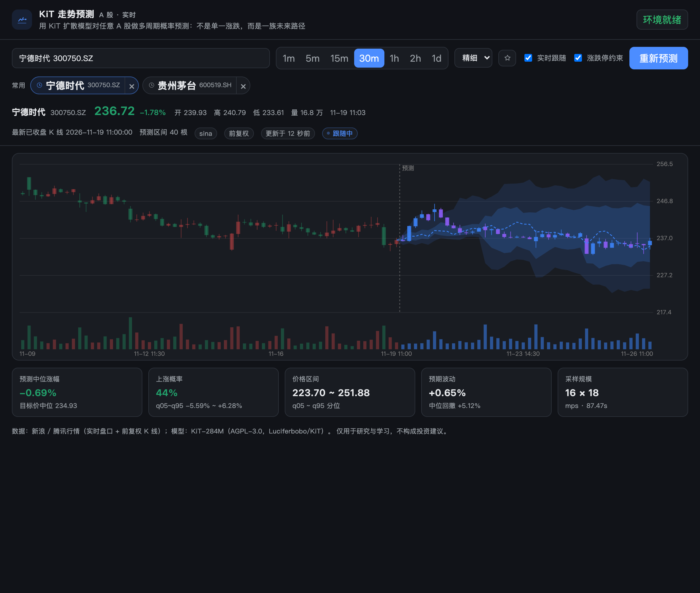
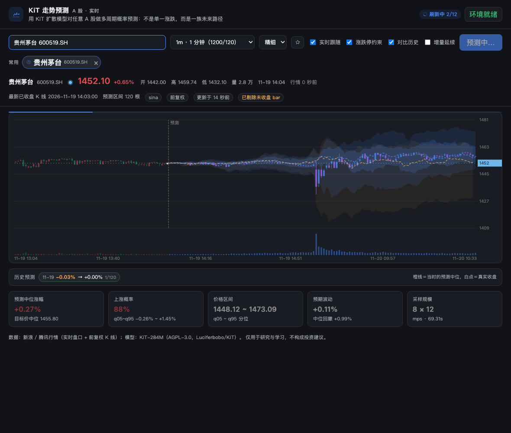
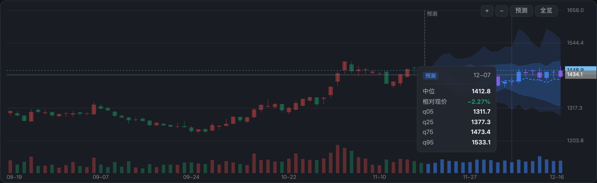
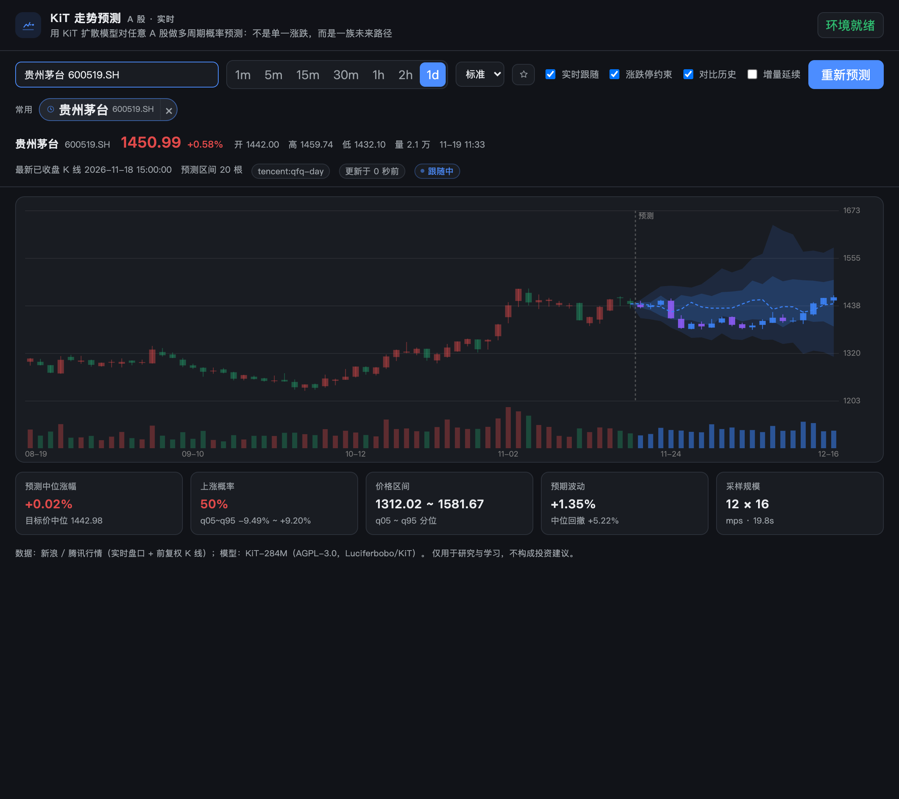
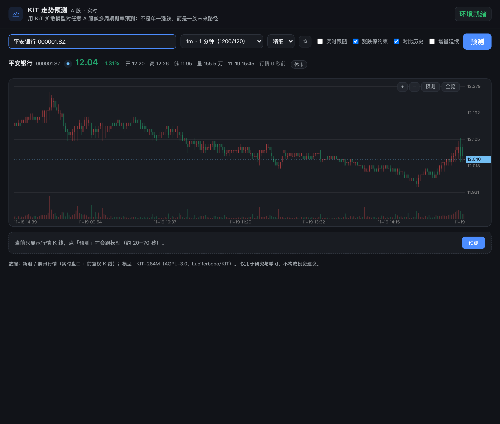

# KiT A 股走势预测（dsh-kit-forecast）

给 DeepSeek Harness 加一个常驻面板：**输入任意 A 股代码，用 KiT 扩散 Transformer 基座模型预测接下来的 K 线走势**。
输出不是一句"涨/跌"，而是若干条采样路径构成的**概率分布**——方向、幅度、区间和不确定性一次看全。

- 模型：[Luciferbobo/KiT](https://github.com/Luciferbobo/KiT)（KiT-L 284M，arXiv:2609.34507），本地推理，不上传你的查询
- 数据：新浪 + 腾讯的实时行情与前复权 K 线，**7 个周期**（1m / 5m / 15m / 30m / 1h / 2h / 日线）
- 形态：侧栏常驻面板，Canvas 画历史 K 线 + 预测分位带 + 中位路径
- 记忆：股票、周期、参数、上次的预测结果都会留存，关掉面板再打开原样恢复；用过的股票自动进「常用」

> 仅用于研究与学习，不构成任何投资建议。



盘中行情每分钟刷新，图上那条淡蓝虚线就是现价（`preview/panel-live.png`）：



默认就能看到最近一整个交易日（`preview/panel-day.png`），放大后悬停看数值（`preview/panel-zoom.png`）：



勾选「对比历史」后，图上会叠加过去预测的中位线与真实收盘（`preview/panel-compare.png`）：



_（截图里「常用」是预测过的股票，右侧「跟随中」表示正在盯最新收盘 K 线）_

选中股票时只画行情，点「预测」才跑模型（`preview/panel-preview.png`）：



## 怎么用

1. 侧栏点「KiT 走势预测」。
2. 首次使用（在别的机器上）点「初始化运行环境」：插件会建 venv、装 PyTorch、下载 1.1 GB 权重（断点续传，只需一次）。
   本机已经预置好，按钮显示「环境就绪」，可以直接预测。
3. 搜索框输入代码或名称（`600519`、`贵州茅台`、`sh601318`、`300750.SZ` 都行），从联想里选一只。
   选中后**只会画出行情 K 线**，不会自动跑模型。
4. 想要预测就点「预测」（图下方也有一条同样按钮的提示条）。默认 **1m + 精细**，
   1m 一档要 1200 根历史，首次跑约 1 分钟，想快就切到 30m/日线或把精度调到「快速」。
5. 行情节拍：**行情每分钟（盘中 15–20 秒）自动刷新**，不需要任何开关，所以 K 线图始终是活的。
   「实时跟随」**默认关闭**——打开后才会在新 K 线收盘时自动重算预测。

### 数据存在哪、存多久

**位置**（Host 侧，不是浏览器 localStorage）：

```
~/Library/Application Support/dsh-desktop/harness/kit-forecast/
├── state.json          面板状态：收藏、上次预测、偏好、历史预测
├── state.json.bak      上一次写入的完整副本（主文件损坏时自动回滚）
├── ckpt/               模型权重（1.07 GB）
└── venv/               Python 依赖环境
```

可用插件配置 `dataDir` 改目录，或用 `statePath` 单独指定状态文件。
`POST /status` 会返回真实的 `store.file` 路径、大小、收藏数与历史条数，方便自查。

**持久化**：写在磁盘上，跨重启、跨窗口都在；写入用「临时文件 + rename」保证原子性。

**保存什么、存多久**：

| 内容 | 是否保存 | 保留策略 |
| --- | --- | --- |
| 常用/收藏股票 | 是 | 最多 24 只；置顶优先，其余按最近使用时间淘汰 |
| 每只股票的上次周期 | 是 | 跟随常用列表，股票被淘汰时一起清理 |
| 偏好（周期、精度、开关） | 是 | 一直保留 |
| 上次的预测结果 | 是 | 只留最新一份（含 400 根历史，约 30–100 KB） |
| 历史预测（用于对比） | 是 | 每只股票+周期最多 12 条，全局最多 120 条，**且超过 30 天自动清理**；同一根 K 线重复预测只留最新 |

实测单条 1m 历史预测约 5.9 KB，120 条最坏情况约 700 KB，通常远小于此。

### 记忆与「常用」

| 行为 | 说明 |
| --- | --- |
| 自动记住 | 预测过的股票进入「常用」列表，最近用过的排前面 |
| 手动置顶 | 工具栏的 ☆ 把当前股票固定到最前 |
| 删除 | chip 上的 × 会把它**彻底删掉**：收藏、记住的周期、历史预测、上次预测一起清，重开面板不会再回来 |
| 兜底 | 即使 state 里还留着不在常用列表里的「上次预测」，面板也不会用它恢复 |
| 记住周期 | 每只股票记住自己上次看的周期，切回来不用重选 |
| 关掉再开 | 面板重新打开时直接回到上次的股票、周期和预测图，不用重新跑 |
| 存在哪 | `…/kit-forecast/state.json`（Host 侧），换窗口也能读到；只存 60 根历史和图表数据 |

### 预测是不是每次都从零算？

**默认是。** KiT 用的是**双向注意力**（`causal=False`）加整段条件，目标窗口整体从纯噪声做
flow matching 积分——没有 AR 模型那种 token-by-token 的自回归结构，所以不存在真正的“KV 缓存增量解码”。

面板上有一个 **「增量延续」** 开关（默认关），它做的是 **SDEdit 式的热启动**：

1. 记住上一次采样的归一化路径 `[K, Lh, F]`；
2. 下一次预测时，如果新 anchor 正好比上次晚一根 bar，就把旧路径整体**左移一格**、末尾补噪声，
   作为这次积分的起点；
3. 从 `tStart=0.6` 开始积分（而不是 `t=1`），步数自动**减半**。

实测（1d、8 路径）：

| 模式 | 步数 | 耗时 | 预测中位 | q05~q95 带宽 |
| --- | --- | --- | --- | --- |
| 全新采样 | 12 | 11.5 s | −2.03% | 13.5% |
| 增量延续 | 12 | 10.2 s | −2.03% | 13.5%（与全新**逐位相同**） |
| 增量延续 | 6 | **5.2 s** | −2.11% | 11.4% |

也就是说：热启动路径本身是正确的（走满步数时结果和全新采样一致），
真正省时间的是**减少步数**，代价是尾部区间变窄一些。适合盘中想快速刷新、能接受轻微偏差的场景。
连续窗口不成立时（比如跨了几天没预测），会自动退回全新采样并在结果里标注 `warm.mode = "fresh"`。

### 和过去的预测对比

勾选工具栏的 **「对比历史」**，图上会叠加之前的预测：

| 元素 | 含义 |
| --- | --- |
| 橙色虚线 | 那条预测当时的**收盘中位** |
| 橙色淡底 | 那条预测当时的 q05–q95 区间 |
| 白色小圆点 | **真实走出来的收盘价**（只画已经收盘的 bar，未走完留空） |

图下方还会给出一行评分：`11-03 +5.49% → -2.56%`，左边是当时预测的累计涨幅、右边是实际走出来的，
边框颜色表示实际值有没有落进 q05–q95。状态文件里每只股票+周期保留最近 12 条，全局最多 120 条。

### 进面板时会发生什么

| 场景 | 行为 |
| --- | --- |
| 打开面板 | 恢复上次的股票、周期与预测图；**不会自动重算**。没有上次结果时只画行情 K 线 |
| 选一只股票 | 只请求历史 K 线画图，显示「当前只显示行情 K 线」的提示条，等你点预测 |
| 换周期 | 清掉旧周期的预测（比例尺不同），改为只加载新周期行情 |
| 点「预测」 | 才真正跑模型；出结果后提示条消失、统计卡出现 |
| 打开「实时跟随」 | 之后每出现一根新的收盘 K 线才自动重算 |

如果行情已经走到了比上次预测更靠后的 K 线，图上会出现一条「行情已更新到 X，刷新预测」的提示，
点它才会重算。

### 数据是实时的吗？

分两层，别混在一起：

| 层 | 频率 | 开关 | 说明 |
| --- | --- | --- | --- |
| **行情**（现价/涨跌幅/成交量/涨停价，**以及 K 线本身**） | 盘中 10–15 秒，休市 2 分钟 | 无，始终开 | 图上淡蓝虚线标出**现价**，右侧轴有价格标签；未收盘的那根 K 线画成半透明动态蜡烛，盘中能直接看它长大 |
| **模型预测**（真正的多路径采样） | 只在手动点「预测」，或打开「实时跟随」且出现新的已收盘 K 线时 | 「实时跟随」默认关 | 1m 档每分钟一次，日线一天一次 |

早期版本把两者绑在一个定时器上，后果是：日线一整天都不刷新价格，看起来像「数据不实时」；
而 30m 档又会每 70 秒重算一次同一根 bar，白烧 GPU。现在拆成「行情心跳」+「新 bar 才重算」两条独立节奏。

心跳发现出现新的**已收盘 K 线**时，会自动重载行情并把它画进图里：

- 预览态（还没预测）：K 线直接向右延伸
- 预测态：新收盘的真实 K 线贴在预测窗口对应的格子上（与预测蜡烛并排），
  可以直接看预测准不准，图不再冻结在预测那一刻

页面切回前台、或窗口重新获得焦点时会立刻补一次心跳，不用等下一个间隔。

### 控件

- 周期、精度都是自绘下拉（勾选态 + 键盘上下/回车/Esc + 点外部关闭），不再用原生 `<select>`
- **「预测」主按钮固定在行情条右侧**：它作用于「当前这只股票」，所以跟股票名、价格放在同一行，
  而不是埋在工具栏末尾。未选股票时按钮禁用

### 预测进度

预测进行中时，图上会盖一层半透明的轻量卡片：圆环百分比 + 阶段名 + 「步 3/12 · 21.0s」+ 取消。
图表本身仍然可见，不会像之前那样把图表往下挤。采样阶段圆环会随扩散步数推进；
卡在「读取 checkpoint」时圆环显示 `···`（还不知道总步数）。

### 刷新时不会闪

「实时跟随」和手动「重新预测」都是**非破坏式**的：旧图一直留在屏幕上，
右上角显示细进度和「刷新中 N/M」，新结果算完才替换；失败也只在顶部出一条提示，旧图继续可用。
只有换股票、换周期这种「目标变了」的情况才会清空旧图。

### 图表交互

| 操作 | 效果 |
| --- | --- |
| 滚轮 | 光标位置为锚点缩放（放大不会跳走） |
| 拖拽 | 左右平移；放大后可拖到任意区间。拖拽监听挂在 window 上，指针移出画布也不会中断 |
| 悬停 | 十字线 + 数值面板跟着光标走，显示开/高/低/收/涨跌/量，预测区另给 q05–q95 与相对现价 |
| `+` / `−` 按钮 | 以视窗中心缩放 |
| `预测` 按钮 | 直接把视窗贴到预测区间（留两倍宽度） |
| `全览` 按钮 | 复位成全部显示 |

放大后纵向范围只按**视窗内的数据**算，所以细节真的会放大，而不是只把横轴拉开。
缩放状态只在**换股票 / 换周期 / 来了一份新预测**时复位成「最近一个交易日」。
不会因为行情每 10~15 秒刷新一次就复位（否则拖完立刻弹回，看起来「拖不动」）。

默认视窗是按周期算的，不是固定根数：

| 周期 | 默认显示 |
| --- | --- |
| 1m | 最近一个交易日（240 根）+ 20 根上下文 + 预测区间（120 根） |
| 5m / 15m / 30m / 1h / 2h | 同理：最近一个交易日 + 上下文 + 预测区间 |
| 1d | 最近 60 个交易日 + 预测区间 |

早盘刚开盘、当天只有几根时，会自动把上一个交易日并进来，不会只剩一小撮。
每根蜡烛窄于 2.2px 时才退化成收盘价折线（例如点「全览」看 500+ 根时）。

### 面板读法

| 元素 | 含义 |
| --- | --- |
| 灰色蜡烛 | **最近一个完整交易日**的已收盘 K 线（日线为最近 60 个交易日） |
| 半透明蜡烛（最右侧） | 当前**未收盘**的那根，随行情实时变化 |
| 蓝色/紫色蜡烛 | 中位路径对应的预测 K 线 |
| 蓝色虚线 | 预测收盘价中位数 |
| 深蓝色带 | q25–q75 分位区间（一半路径落在这里） |
| 浅蓝色带 | q05–q95 分位区间（90% 路径落在这里） |
| 预测中位涨幅 | 预测窗口末端的累计对数收益中位数 |
| 上涨概率 | 采样路径里末端收益 > 0 的比例 |
| 价格区间 | q05 ~ q95 对应的目标价 |
| 预期波动 / 中位回撤 | 单根 bar 对数收益的标准差中位数 / 最大回撤中位数 |

## 数据源

插件在运行时直接向公开行情接口取数，**不需要任何 token 或账号**，并按下面的顺序自动降级：

| 用途 | 主源 | 备源 | 说明 |
| --- | --- | --- | --- |
| 实时盘口（含涨跌停价） | `qt.gtimg.cn`（腾讯） | `hq.sinajs.cn`（新浪） | 2.5 秒缓存，用于行情条与涨跌停约束 |
| 1m/5m/15m/30m/60m K 线 | `quotes.sina.cn` | `money.finance.sina.com.cn` | 单次最多 1500 根，足够覆盖模型窗口 |
| 2h K 线 | 由 60m 聚合 | — | A 股 2h 网格是 11:30 / 15:00 各一根 |
| 日线（前复权） | `web.ifzq.gtimg.cn` qfq | 新浪日线 | 前复权口径与 KiT 训练数据一致 |
| 复权因子 | 腾讯 qfq 日线 ÷ 新浪原始日线 | — | 把分钟线也拉到前复权口径，避免除权跳空污染特征 |
| 交易日历 | 上证指数日线 | — | 用于生成未来 bar 的时间戳 |

几个刻意的处理：

- **只用已收盘的 bar**：正在走的最后一根会被丢弃（否则模型看到的是残缺 OHLC）。
- **时间戳用收盘时刻**并对齐 KiT 的会话网格（9:31–11:30 / 13:01–15:00），脏数据会被过滤。
- **涨跌停投影**：用盘口给出的真实涨停价反推幅度（主板 10%、创业板/科创板 20%、北交所 30%、ST 5%），把采样路径夹回当日可交易区间。

## 模型与服务

- 权重：`step_market_284M.pt`（KiT-L，283.7M 参数，EMA 权重），从 `hf-mirror.com`（默认镜像）下载到 `dataDir/ckpt`。
- 推理：`runtime/engine.py` 是常驻 worker，JSON Lines 协议；模型加载一次后常驻，Host 半通过 stdin 派发任务。
- 采样：rectified-flow 欧拉积分，`K` 条路径 × `N` 步；默认预算按周期不同（日线 16×24，1m 6×12），面板上可选「快速/标准/精细」。
- 设备：自动选 `cuda → mps → cpu`。没有 GPU 的机器也能跑，只是慢；面板会显示实际耗时。

实测（Apple M4 / 16 GB，`device=mps`，首次加载权重约 4–5 秒）：

| 周期 | 默认采样（路径 × 步数） | 单次耗时 | 主要开销 |
| --- | --- | --- | --- |
| 1d | 12 × 16 | 10–25 s | 序列 270 token，最便宜 |
| 2h / 1h | 8 × 14 | 18–28 s | 序列 380 / 420 token |
| 30m | 8 × 12 | 20–30 s | 序列 680 token |
| 15m | 6 × 10 | 18–26 s | 序列 864 token |
| 5m | 6 × 10 | 22–32 s | 序列 1056 token |
| 1m | 4 × 8 | 18–25 s | 序列 1320 token，注意力最重 |

耗时约等于「路径数 × 步数 × 单序列前向」；面板上的「快速 / 标准 / 精细」按 0.5× / 1× / 2× 放大采样预算。
CPU-only 的机器约慢 3–8 倍，可以先用日线。

各周期的模型窗口（KiT 固定，不能改）：

| 周期 | 1m | 5m | 15m | 30m | 1h | 2h | 1d |
| --- | --- | --- | --- | --- | --- | --- | --- |
| 历史 Lc | 1200 | 960 | 800 | 640 | 400 | 360 | 250 |
| 预测 Lh | 120 | 96 | 64 | 40 | 20 | 20 | 20 |

## 安装

```bash
# 在 DSH 里安装本地目录（会链接这个 checkout，改动后重装即可生效）
dsh plugin --profile desktop add /abs/path/to/dsh-kit-forecast
```

或者在 Plugin Manager 里安装同目录下打包出的 `.tgz`。安装后 `cordis.patch.yml` 会插入一行：

```yaml
- insert:
    - id: kit-forecast
      name: 'dsh-kit-forecast'
```

### 配置

在那一行下加 `config`（没有声明 Schema，取值都会做范围收敛）：

```yaml
- insert:
    - id: kit-forecast
      name: 'dsh-kit-forecast'
      config:
        dataDir: /path/to/runtime     # venv + 权重目录，默认 $DSH_HOME/kit-forecast
        python: /path/to/python3      # 已有 torch 环境的解释器，默认 dataDir/venv/bin/python
        device: auto                  # auto | cpu | mps | cuda
        indexUrl: https://pypi.tuna.tsinghua.edu.cn/simple   # pip 镜像（可选）
        hfHost: https://hf-mirror.com # 权重镜像（可选）
        maxPaths: 32                  # 单次采样路径上限
        maxSteps: 48                  # 单次扩散步数上限
        timeoutMs: 900000             # 单次预测超时
```

## 接口

面板用的都是 `connection.fetch` 下注册的 `/api/kit-forecast/*` 路由（同源 + 凭据校验，不走外网端口）：

| 路由 | 作用 |
| --- | --- |
| `POST /status` | 运行环境：Python / torch / 权重是否就绪、各周期默认预算 |
| `POST /search` | 代码或名称联想 |
| `POST /quote` | 实时盘口 |
| `POST /bars` | 指定周期的历史 K 线（不跑模型，画图用） |
| `POST /forecast` | SSE：`stage` → `progress` → `result`，最后 `done` |
| `POST /setup` | SSE：初始化环境（建 venv / 装依赖 / 下载权重），逐行回显日志 |
| `POST /state` | 读取/合并写入面板状态（常用股票、上次预测、偏好） |
| `POST /tick` | 轻量心跳：最后一根已收盘 bar + 盘口，用于判断要不要重算 |
| `POST /history` | 历史预测与真实走势的对比（含评分） |

## 目录结构

```
src/host/index.js       路由、SSE、初始化流程、涨跌停规则
src/host/datasource.js  行情抓取、复权、周期聚合、已收盘 bar 过滤
src/host/engine.js      Python worker 生命周期与 JSON Lines 调度
src/host/state.js       面板状态持久化（state.json，原子写入 + 损坏回落）
src/client/             面板、Canvas 图表、样式、文案
runtime/engine.py       推理 worker（构造窗口 → 采样 → 反归一化 → 汇总）
runtime/kit_v1/         KiT 官方模型代码（AGPL-3.0，原样引入，见 runtime/KIT_LICENSE）
scripts/fetch-model.mjs 多连接分段下载权重
scripts/build.mjs       esbuild 打包 client + 复制 host 到 lib/
```

## 正确性说明

- **和官方参考对齐**：用官方 demo 数据（`300591.SZ` 5m，anchor 2026-01-23）跑同一套窗口构造与采样，
  得到的末端收益中位数 −4.8%（官方发布结果 −5.6%，差异来自随机种子），随后 96 根真实 bar 的实际值 −5.8%，
  说明特征、规范化、日历特征与采样器与论文实现一致。
- **测试覆盖**（`npm test`，73 项）：代码归一化、会话网格过滤、未收盘 bar 剔除、前复权因子匹配、
  `/forecast` 的 SSE 事件顺序、种子可复现性、涨跌停幅度推断、K 线不足与非法输入的报错路径；
  状态文件读写/合并/损坏回落/外部改动检测、常用股票排序与上限、相对时间格式化；
  `/state`、`/tick`、`/history` 的路由契约；历史预测与真实 bar 的对齐、未实现部分留空、评分字段；
  `/tick` 单边失败与双失败分支；画布 `draw` 的依赖数组完整性；
  图表视窗算术（缩放锚点、边界收敛、平移、像素→下标）；默认视窗按交易日取景（含早盘并入上一日）；
  「进面板不预测」的契约（默认关闭跟随、选股不预跑、换周期清结果、nPred=0 仍可画图）；
  持久化约束（置顶不因预测丢失、历史上限与 30 天过期、.bak 回滚、statePath 隔离）；
  切换股票/周期的契约（图表数据必须匹配当前目标、旧结果要清、overlay 补拉不死循环、联想令牌）；
  删除股票必须删干净（forget 清 watchlist/notes/history/last，重开不复活）。
  其中一项会用真实权重跑两次预测，断言两条结果逐位相同。

## 已知限制

- 权重 1.1 GB，首次初始化受网络影响较慢；已支持断点续传，中断后重新点初始化即可继续。
- 无 GPU 时 1m/5m 这种长窗口会比较慢，建议先用日线。
- 1m 周期只能用 1500 根不到的分钟数据（约 6 个交易日），体积 EMA 的预热不完整，越靠前的 bar 影响越大；模型窗口要求的下限是 1200 根。
- 分钟线只做了**按日前复权**（用复权因子缩放时，同一交易日内所有 bar 用同一因子），跨除权日的形态与严格前复权略有差异。
- 模型是"研究用"基座：它给的是条件分布采样，不保证方向准确，也不含任何基本面/新闻信息。

## 本机已安装状态（2026-11-18）

| 项 | 值 |
| --- | --- |
| 插件 | `dsh-kit-forecast@1.4.5`，已装进 `desktop` profile（Plugin Manager 安装，立即生效） |
| 运行时目录 | `~/Library/Application Support/dsh-desktop/harness/kit-forecast` |
| 虚拟环境 | `…/kit-forecast/venv`（Python 3.12 + torch 2.15.0 + numpy 2.2.6 + pandas 2.3.3） |
| 权重 | `…/kit-forecast/ckpt/step_market_284M.pt`（1.07 GiB，官方 KiT-L） |
| 推理设备 | Apple M4 / `mps`，fp32；首次加载权重约 4–5 秒 |
| 自检 | `npm test` 73 项全过（含真实权重的确定性对比）；`npm run check` 走通 status/search/quote/bars/forecast |

浏览器半是随插件加载的模块，需要 **重启一次 Harness**（或重开桌面窗口）让它进入新的模块代，
侧栏才会出现「KiT 走势预测」；Host 半的路由已经随安装即时生效。

## 许可

本插件以 **AGPL-3.0** 发布，全文见 [LICENSE](LICENSE)，第三方组件与「对应源代码」说明见 [NOTICE](NOTICE)。

原因是它引入了 [Luciferbobo/KiT](https://github.com/Luciferbobo/KiT) 的模型代码（`runtime/kit_v1`，AGPL-3.0，上游 LICENSE 副本在 `runtime/KIT_LICENSE`）。
相应地：**如果你修改后分发本插件，或把它作为网络服务对外提供，需要按 AGPL-3.0 第 13 条向使用者提供对应源代码。**

- 模型权重不随仓库分发，由 `npm run model` 或面板的「初始化」从 [Lucifer744/KiT_model](https://huggingface.co/Lucifer744/KiT_model) 下载，适用上游许可。
- 行情数据来自新浪财经、腾讯财经的公开接口，版权归各数据源所有；仓库只含读取代码，不含数据。
- 本项目仅供研究与学习，不构成任何投资建议。
